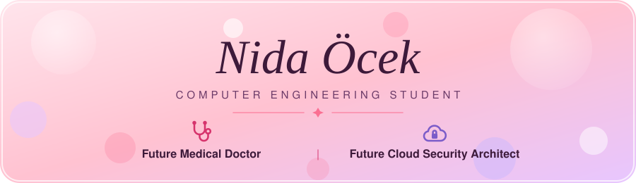
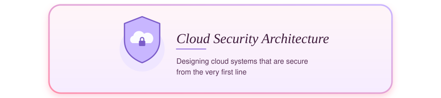
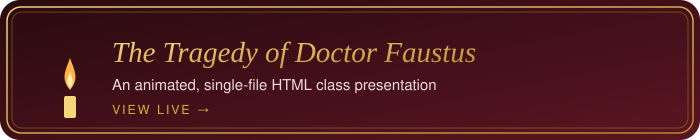

## About me

I'm **Nida &Ouml;cek**, a Computer Engineering student with two big dreams: 
to become a **medical doctor**, and a **Cloud Security Architect** 
who designs cloud systems that are secure from the very first line.

I work hard for these goals and improve myself every day.

## Projects

[Repository](https://github.com/nidaocek/sunum) &nbsp;&middot;&nbsp; [View it live](https://nidaocek.github.io/sunum/)

*"Every day is a chance to learn something new."*

